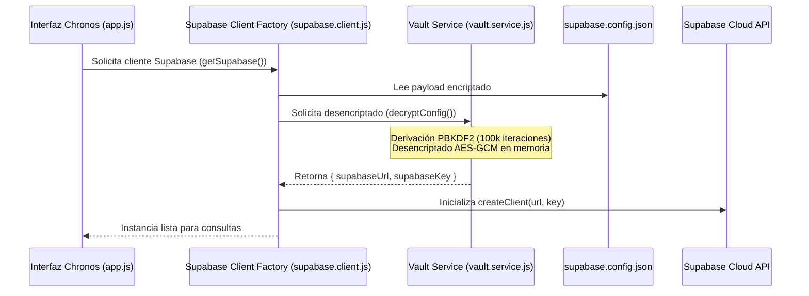

# Especificación de Seguridad: Vault Cifrado de Supabase

Este documento detalla el mecanismo de protección criptográfica implementado para resguardar las credenciales del proyecto **Chronos** (URL y clave publicable de Supabase).

---

## 🔐 Algoritmo y Estándares

El resguardo de credenciales se realiza sin exponer texto plano dentro del código fuente ni en el repositorio de control de versiones.

1. **Algoritmo de Cifrado**: **AES-GCM (Galois/Counter Mode)** con clave de **256 bits**.
2. **Función de Derivación de Clave (KDF)**: **PBKDF2** con **100,000 iteraciones** y función hash **SHA-256**.
3. **Vector de Inicialización (IV)**: Generado aleatoriamente con entropía criptográfica (12 bytes) para cada cifrado.
4. **Sal (Salt)**: 16 bytes generados de manera criptográficamente segura.
5. **Estándar de Implementación**: **Web Crypto API (`globalThis.crypto.subtle`)**, nativo en navegadores modernos y entornos JavaScript compatibles.

---

## 📦 Estructura del Archivo `supabase.config.json`

El archivo de configuración cifrado se ubica en:
- `webapp/src/config/supabase.config.json`
- `android/app/src/main/assets/config/supabase.config.json`

```json
{
  "algorithm": "AES-GCM",
  "kdf": "PBKDF2",
  "iterations": 100000,
  "hash": "SHA-256",
  "salt": "P93aH4UWUP1UHUhBPOEhVQ==",
  "iv": "tN1UPjKKahdf9JuX",
  "ciphertext": "CJXcOdfi8socUFmiXSp30j0cxfQU4y5DrgWoB5SWJN16Epoj+QPtlAxc5Iqgpd7soLwSsZPbHcVC+hmo0wGYzuyOjq3umceaOqoiumb0lTX35Jq/pzqaZj07JMamdTcyE+X8tI1uZ6EcLfNNFBuf8/C7vbDh5kNcvqA7Q3xQjNNFLIUCPv3L0fs="
}
```

---

## ⚡ Flujo de Desencriptado Bajo Demanda



---

## 🛡️ Beneficios de Seguridad
- **Protección contra escaneos automáticos de secretos**: Las herramientas automatizadas que escanean repositorios en busca de tokens y URLs de Supabase no pueden detectar las credenciales en texto plano.
- **Sin dependencias pesadas**: Emplea el estándar nativo Web Crypto API sin requerir paquetes externos no auditados.
